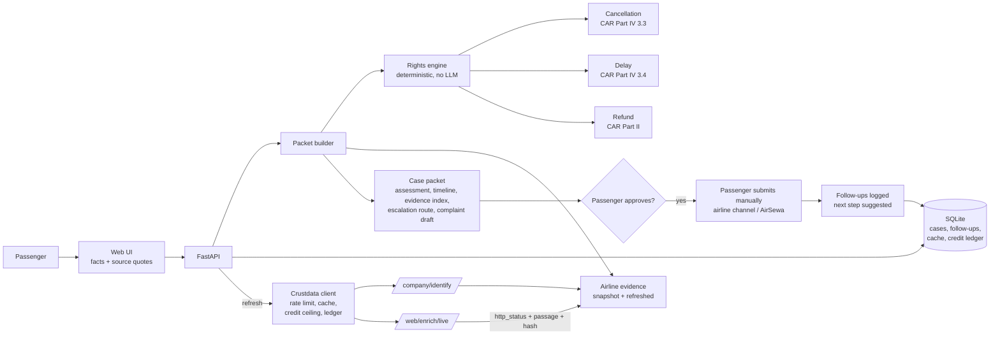
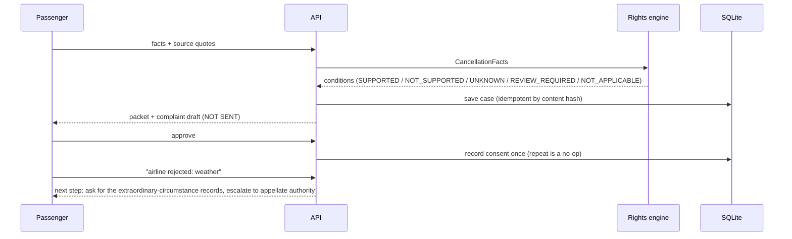

# FLIGHTBACK architecture

## What is deterministic and what is data

| Layer | Source of truth | Can it be wrong silently? |
|---|---|---|
| Legal rules (`flightback/rules.py`) | Official DGCA PDFs, checked paragraph by paragraph (`docs/rule-verification.md`) | No: each pack carries `verified` and a source URL; the unverified Part II warns on every refund case |
| Passenger facts | The passenger's documents, quoted in the evidence index | No: facts with no document are labelled "stated by passenger, no document" |
| Airline identity and grievance route | Crustdata, dated, with HTTP status and passage hash | No: blocked, empty or conflicting pages become "CANNOT VERIFY" or a conflict warning |
| Compensation amount | `min(cap, basic fare + fuel charge)`, computed only when every input is known | No: missing inputs are named, no amount is shown |

## Cancellation case lifecycle

## Crustdata usage

| Call | Why | Cost control |
|---|---|---|
| `/company/identify` by official domain | Canonical airline identity; domain match at confidence >= 0.9, else REVIEW_REQUIRED | 0.2 credits, cached 24h |
| `/web/enrich/live` on the airline's grievance page | Dated nodal officer / appellate authority emails | 1 credit per page, cached; only the relevant passage and its SHA-256 are stored |

Every call passes through one client: per-endpoint rate limit (5/min core, 10/min web on this key), credit ceiling that can
be cut at runtime and survives a restart, a ledger row per call with `X-Request-Id` and `X-Credits-Used`, 429 backoff using
`x-ratelimit-reset`, and typed 402 / 403 errors.

## Scaling answer (100x volume, or a second client)

- The rights engine is a pure function of the facts: scale it horizontally with no coordination.
- Airline evidence is shared across all passengers: one refresh per airline per day, not per case. At 100x the Crustdata spend does not grow with case volume.
- A second client (a travel agency) gets its own case namespace and, if needed, its own credit ceiling through the same ledger.
- The limit that does grow is document handling. That is why intake records every fact's source document and quote, ready for an extraction step.
